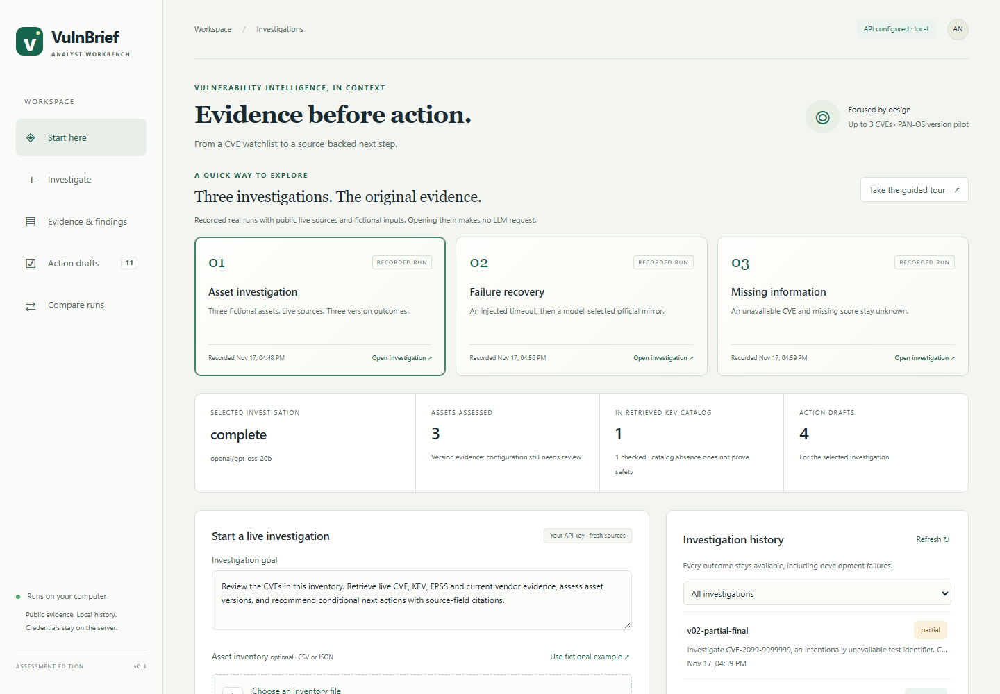
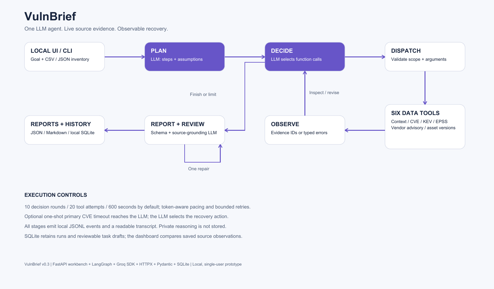

# VulnBrief v0.3

[](https://github.com/Avan1sh/vulnbrief/actions/workflows/ci.yml)


A single LLM agent that investigates a small CVE watchlist, chooses live tools, revises its actions after failures, and produces an evidence-linked prioritization report.

The upgraded local workbench adds asset/version checks, current vendor guidance, field-level recommendation citations, reviewable task drafts, persistent investigation history, and snapshot comparisons. Version applicability is a deliberately narrow PAN-OS pilot; unsupported cases remain unverified.

The model makes the plan, tool selections, priorities and recommendations. Python validates inputs, executes read-only tools, records evidence and bounds the run. No stored answers, canned report mode, severity-to-priority lookup table, or copied public agent implementation is used.



[Watch the actual 90-second walkthrough](https://github.com/Avan1sh/vulnbrief/releases/download/v0.3.0/vulnbrief-demo.webm) · [Inspect a cited source value](docs/screenshots/evidence-inspector.png) · [Phone layout](docs/screenshots/mobile.png)

The silent video shows the real local application opening recorded LLM/source runs. It makes no new LLM requests and is labeled accordingly. Video is distributed separately as a release asset to keep the assessment source ZIP below 10 MB.

## Review the project

| Start here | What it demonstrates |
| --- | --- |
| [Architecture](docs/architecture.png) / [one-page design](docs/design-writeup.pdf) | Components, decisions and limitations |
| [Asset investigation](artifacts/v02-reviewed/report.md) / [trace](artifacts/v02-reviewed/transcript.md) | Six tools, three fictional assets, exact evidence fields |
| [Failure recovery](artifacts/v02-recovery-final/transcript.md) | A deliberately injected timeout and model-selected recovery |
| [Missing-data report](artifacts/v02-partial-final/report.md) | Partial status and unknown information preserved |
| [Evaluation](artifacts/evaluation-summary.md) / [source review](docs/source-review.md) | Actual outcomes, failed attempts and known limits |

The retained reports can be reviewed without a key. A new live investigation uses your own provider credentials and fresh source requests. The three selected runs are demonstrations, not a statistical reliability claim.

## Quick start

Requires Python 3.10 or later, internet access, and a Groq API key. Tested with Python 3.10.11 on Windows. The model defaults to `openai/gpt-oss-120b`; free access and quotas depend on the provider/account. Create a key at [Groq Console](https://console.groq.com/keys). No paid search API is required.

Clone the public repository, then create the local environment. In PowerShell:

```powershell
git clone https://github.com/Avan1sh/vulnbrief.git
Set-Location vulnbrief
py -3.10 -m venv .venv
.\.venv\Scripts\python.exe -m pip install -e '.[dev]'
Copy-Item .env.example .env
# Edit .env and set GROQ_API_KEY. Never commit this file.
.\.venv\Scripts\python.exe -m vulnbrief doctor
.\.venv\Scripts\python.exe -m vulnbrief run 'Review the selected CVE watchlist, check live exploitation evidence, and prioritize investigation with sources and uncertainty.' --context examples/synthetic_context.json
```

On macOS/Linux:

```bash
git clone https://github.com/Avan1sh/vulnbrief.git
cd vulnbrief
python3 -m venv .venv
.venv/bin/python -m pip install -e '.[dev]'
cp .env.example .env
# Edit .env to set GROQ_API_KEY.
.venv/bin/python -m vulnbrief doctor
.venv/bin/python -m vulnbrief run 'Investigate CVE-2024-3400 using live sources and identify unknowns.'
```

Run commands from the project directory: only its `.env` is loaded. Existing environment variables take precedence. The CLI prints the output directory; inspect `report.md`, `report.json`, `transcript.md`, and `events.jsonl`. A specified `--output` must be a **new** directory. Exit codes: 0 complete, 2 useful partial report, 1 failed/configuration error.

If the default model's quota is unavailable, set `VULNBRIEF_MODEL=openai/gpt-oss-20b` in `.env`, pass `--model openai/gpt-oss-20b` to `run`, or select the smaller model in the workbench. A model change does not bypass validation. The retained upgraded runs took approximately three to seven minutes on the tested account.

## Analyst workbench

```powershell
.\.venv\Scripts\python.exe -m vulnbrief serve --port 8787
```

Open [the local dashboard](http://127.0.0.1:8787). It provides goal entry, CSV/JSON inventory selection, model selection, live execution events, findings, asset assessments, expandable source observations, artifact downloads, task review/export, and two-run comparisons. It uses FastAPI with a small HTML/CSS/JavaScript frontend, without a Node build step. Binding is restricted to localhost. This is a single-user prototype; do not expose it as a public service.

Start with **Asset investigation**, **Failure recovery**, or **Missing information**. Each opens an explicitly dated original run without using a key. The six-step **guided tour** visits the version outcomes, an exact citation, the injected timeout, unknown information, task drafts, and live-input controls. It never starts a new investigation. The default selection is the successful asset demonstration; all development failures remain in the filterable history.

Click a citation to open the evidence inspector. It places the selected claim beside the original source field, source URL, retrieval timestamp and source date; missing null values stay visible. Escape closes the dialog and returns keyboard focus. The KEV summary distinguishes retrieved catalog absence from missing or conflicting observations. Tabs support arrow keys, and drafts show the selected investigation unless **Show all investigations** is enabled.

Use **Use fictional example** to load `examples/asset_inventory.csv`. That inventory includes a potentially affected version, a version matching the vendor's unaffected range, and a missing version. No real asset is scanned. Inventory context is included in requests to the configured LLM; use synthetic/non-sensitive inputs for the assessment.

One worker executes investigations sequentially, with at most three queued/running jobs. Credentials stay server-side and are not returned by the API. Cross-origin mutation requests are rejected. Model/source text is rendered as text rather than executable HTML. v0.3 adds isolated Chromium checks at 1440, 768 and 390 pixels, automated accessibility scans, keyboard/modal checks and inspected real screenshots. These checks do not constitute full accessibility certification or cross-browser coverage. See the [verification record](docs/verification-v03.md).

## Asset assessment and current advisories

```powershell
.\.venv\Scripts\python.exe -m vulnbrief run 'Read the inventory, investigate its CVEs using live sources and current vendor guidance, assess versions, and produce conditional actions with exact source fields.' --context examples/asset_inventory.csv --model openai/gpt-oss-20b
```

The LLM chooses when to call `get_vendor_advisory` and `assess_assets`. The advisory tool accepts CVE IDs, not arbitrary URLs. It requires a retrieved CVE record containing the exact official Palo Alto advisory reference, fetches the live page, and parses its published product-status table, source dates and fixed-version candidates. A short solution excerpt is kept with the source URL. Unsupported vendors return a typed gap.

The comparison tool supports numeric `major.minor.patch` and PAN-OS `-hN` hotfix versions. It evaluates explicitly listed affected/unaffected conditions in the same patch branch. It does not infer fixed status for unlisted future branches, parse arbitrary distro/backport versions, or prove that configuration prerequisites are present. Results are `potentially_affected`, `not_affected_by_version`, or `unverified`. Conflicting tables remain unverified. Version arithmetic is a tool operation; investigative choices and priorities still come from the LLM.

CSV columns: `label,cve_id,product,product_version,exposure,business_importance,owner`. Optional `origin` and `notes` columns identify synthetic context. JSON follows the existing context schema with optional `product` and `owner` asset fields. Each asset/CVE pair must be unique. Existing v0.1 context files remain valid.

## Action drafts and saved investigations

New-format reports generate local task drafts with asset, owner, agent priority, action, prerequisites and exact evidence fields. Assets marked unaffected by the version comparison do not receive remediation drafts. Every generated action starts as a draft. Accepting/dismissing a draft records the analyst's review; it does not patch a device, send a message, or create a ticket in an external service. CSV export protects against spreadsheet formula execution.

History and review states persist in `.vulnbrief/history.sqlite3`; queued/running jobs are marked interrupted after a server restart. **Edit & re-run** loads saved inputs so missing information can be supplied in a fresh investigation. It does not resume an old LLM checkpoint. The comparison view shows observed KEV, EPSS, vendor-table and asset-version differences, distinguishing missing observations from changed values. Nothing is scheduled automatically.

CLI runs also save history. `python -m vulnbrief history` lists it. The dashboard imports the retained `final-*` baseline and `v02-*` upgrade artifacts; old reports are labeled archived and do not acquire invented action citations. SQLite state, uploaded inputs, credentials and the virtual environment are excluded from the submission ZIP.

`doctor` makes two LLM requests to verify structured output and genuine tool calling; it does not execute public data tools. Missing credentials/provider failure never activate a canned response.

## Failure recovery demonstration

```powershell
.\.venv\Scripts\python.exe -m vulnbrief run 'Investigate CVE-2024-3400 using live CVE, KEV and EPSS evidence. Revise your approach if a source fails.' --inject-failure cve-primary-timeout-once
```

This flag injects one explicitly labeled timeout into the first primary CVE request. The error is returned to the LLM. The LLM decides whether to retry, select the official mirror, or report a gap; Python does not automatically substitute the mirror. Subsequent source requests are real HTTPS requests. Model choices may vary between runs. The injected fault fires only if the agent selects a primary CVE request.

To exercise unavailable information:

```powershell
.\.venv\Scripts\python.exe -m vulnbrief run 'Investigate CVE-2099-9999999 using live CVE, KEV and EPSS tools. This is an intentionally unavailable test identifier; report missing evidence honestly.'
```

## How the agent works

1. **Plan:** the LLM returns a schema-validated objective, short steps and assumptions before any data tool executes.
2. **Decide:** native function calling selects tools and arguments. Several independent requests can be selected in one round.
3. **Observe:** the runtime validates scope, performs tool calls and returns typed results/errors. New observations go back to the same agent.
4. **Revise or finish:** the model can choose another source, retry, gather more context, call `finish_investigation`, or end with a text answer. A text answer still passes through structured report generation and evidence validation.
5. **Report:** a separate schema-constrained response receives fresh original observations (excluding earlier assistant prose) and supplies judgments with evidence IDs. Structural checks and a separate source-grounding LLM review can request one repair. A second rejection fails the run honestly. Source observations are attached directly by the runtime and rendered to Markdown.



See the editable [diagram source](docs/architecture.mmd) and [design write-up](docs/design-writeup.pdf).

The visible plan and public action summaries are the planning trace. Private model reasoning is neither requested for display nor persisted. Native function choices and their observations make execution auditable even when the provider returns no accompanying text.

If the model ends tool selection with prose, that response is used only as a finish signal. Its unsolicited draft text is discarded; the trace labels the transition and the report stage receives fresh original observations. This avoids presenting unvalidated draft claims as an accepted report.

| Data tool | Live source / behavior |
| --- | --- |
| `read_context_file` | Reads only the file explicitly selected through `--context`; the LLM cannot supply a path |
| `get_cve_record` | CVE Program/CNA record via CVE Services; alternative is CVEProject's official JSON data repository |
| `lookup_kev` | CISA known exploited catalog; alternative is CISA's official data mirror |
| `get_epss` | FIRST exploitation probability and percentile, including score date |
| `get_vendor_advisory` | Current supported vendor reference, product status table and solution information |
| `assess_assets` | Compare selected inventory to retrieved vendor table, retaining source-field basis and unknowns |

Tools use fixed official endpoint hosts and bounded validated CVE IDs. Vendor references are cited as source-provided links, not automatically browsed. The KEV catalog is fetched once per source **within a run**, then filtered locally. Nothing is replayed from the submitted example reports during a live run.

## Input scope and mock-data disclosure

Specify up to three CVEs in the goal, the context file, or both. Context format:

```json
{
  "origin": "synthetic",
  "notes": "Fictional watchlist; version and applicability unknown",
  "assets": [
    {
      "label": "edge-service",
      "cve_id": "CVE-2024-3400",
      "exposure": "Internet-facing",
      "business_importance": "High",
      "product_version": null
    }
  ]
}
```

`origin` accepts `synthetic` or `user_supplied`. Maximum 50 KB, 12 assets and three distinct CVEs. A watchlist association is **not a confirmed scanner finding**. The included environment is fictional; vulnerability information is fetched live. Unit tests use synthetic HTTP responses and a clearly identified scripted model double. They are not LLM performance evaluations. See [scenario descriptions and behavioral labels](examples/scenarios.json).

## Evidence and reliability

- Every successful observation has an evidence ID, source URL, retrieval time, source date if available, and primary/mirror/input location.
- Failed requests have a separate `ERR...` namespace with tool arguments, code and time; errors never consume or invalidate successful `E...` evidence IDs.
- Summaries and recommended actions cite JSON-pointer paths directly inside `evidence.data`. References are checked for existence and CVE/asset-row scope. Action prerequisites are required. Valid pointers make support inspectable; they are not a semantic proof.
- If an action names a concrete version, the same version must occur in its cited source values. Runtime-generated `version_citations` help prevent selecting a neighboring fixed-version entry. This check does not prove every natural-language inference or version-range statement.
- An additional guard checks common upgrade/install wording: a named target must cite its exact current vendor `fixed_version_candidates` entry. An affected-version description cannot supply that proof. This lexical check is deliberately narrow; it is not a complete natural-language verifier.
- A selected inventory that was not read and assessed prevents complete status. Plan JSON gets at most one schema correction before data tools; provider failures still stop explicitly. The model chooses its tools and next actions.
- Source-assigned CVSS values are attached directly by the runtime and displayed separately from the LLM's priority judgment. Missing source severity is not filled with an invented metric.
- Failed KEV retrieval is unknown, not absence. Catalog absence does not prove no exploitation.
- Missing EPSS remains null. EPSS is general exploitation likelihood over the next 30 days, not the probability a particular asset will be compromised.
- CVE records can be published, rejected or reserved. Missing scores, fixed versions and asset applicability are not invented.
- CVSS, if supplied by the CNA, retains its version/source. We do not query NVD or substitute model-memory scores.
- Mirrors are alternate copies, not independent confirmation. Conflicting CVE observations prevent complete status. Source freshness still requires review.
- Structural validation proves reference correctness; a separate LLM review looks for unsupported claims, EPSS overstatement and historical patch assumptions. Neither proves semantic truth. A human must verify recommendations and their supporting sources before operational use.
- The runtime has no patching, exploitation, scanning or general-purpose shell tool. Source text stays in untrusted data observations; prompt injection remains an LLM risk.

Defaults: 10 decision rounds, 20 data-tool attempts, 600 seconds, one report repair. Each network request has a deadline-limited timeout; source JSON is limited to 5 MB and vendor HTML to 2 MB. `--max-rounds`, `--max-tool-calls`, and `--max-seconds` change bounds within documented CLI ranges. Exhaustion yields a partial result if possible, otherwise a failed run artifact. SQLite retains observations and task reviews; there is no resumable graph checkpoint or autonomous long-term memory.

Groq requests use the larger of `VULNBRIEF_MIN_REQUEST_INTERVAL` (default 25 seconds) and conservative token-aware pacing targeting 6,000 tokens/minute. A rate-limit response receives at most one bounded retry honoring Retry-After up to 60 seconds. Daily quota exhaustion fails promptly with a clear message; it is not retried indefinitely. Protocol/schema-generation failures have a bounded correction attempt. Individual requests time out at 40 seconds or the remaining run budget. API errors are recorded without failed-generation/private reasoning bodies or credentials.

The default model is GPT-OSS 120B. `--model openai/gpt-oss-20b` and the dashboard selector provide a smaller supported free alternative. The smaller endpoint intermittently rejected strict-schema generations in testing, so it uses JSON mode with the same local Pydantic contract and bounded report repair. It has no exemption from evidence validation. Provider quotas and availability remain account dependent.

## Tests and sample evidence

```powershell
.\.venv\Scripts\python.exe -m pytest -q
```

Tests cover missing scores, invalid probabilities, malformed sources, incomplete catalogs, context/path restrictions, injected faults, error observations, stopping bounds, report repair and reference scope. The instruction-like source fixture tests message-role isolation only; it does not establish model-level prompt-injection resistance.

Upgrade regressions also cover hotfix boundaries, unsupported branches, CSV parsing, vendor tables, conflicting version evidence, field-level citations, error/evidence IDs, task-review persistence, SQLite restart behavior, snapshot differences, queued API jobs, downloads and cross-origin writes. Windows sandboxed asyncio may need loopback socket access for TestClient tests; this was an environment restriction, not a change to the product's security settings.

Real sample runs and actual metrics are in [sample runs](artifacts/sample-runs.md) and [evaluation summary](artifacts/evaluation-summary.md). Raw events and the full structured source observations are included alongside each report. These artifacts are examples, not the source of runtime responses. A three-run sample cannot establish production reliability or classifier precision/recall.

The unit/API suite needs no API key. [GitHub Actions](https://github.com/Avan1sh/vulnbrief/actions) runs those checks on Ubuntu with Python 3.10/3.12 and Windows with Python 3.10, checks presentation logic/publication hygiene, and builds a wheel. A separate Ubuntu job exercises the actual reviewer flow and automated accessibility checks in Chromium. Live LLM evaluation remains separate. See [contributing](CONTRIBUTING.md), [security scope](SECURITY.md), and [changelog](CHANGELOG.md).

## Repeated-trial agent evaluation

[Eight self-authored cases](examples/evaluation-suite.json) define observable expectations for missing records, unsupported vendors, version boundaries, timeout recovery, unknown versions, context injection, mixed watchlists and scope limits. They prescribe neither a fixed tool sequence nor a fixed priority/answer. The [executed v0.3 batch](artifacts/evaluation-v03/summary.md) records each actual trial, checks, model, runtime fingerprint, bounds, tokens and latency. Defined cases that were not executed are not counted as successful tests.

```powershell
.\.venv\Scripts\python.exe scripts/evaluate_agent.py --cases missing_record,unsupported_vendor,scope_guard --trials 2 --max-total-tokens 80000 --output artifacts/my-new-evaluation
```

This uses real Groq requests and live public sources; configure your own key and use a **new** output directory. The token limit is checked between trials and may be exceeded by the last trial. Each trial is additionally bounded to eight decision rounds, twelve data-tool attempts and 480 seconds by default. Daily quota exhaustion stops the batch explicitly. No source responses or LLM outputs are mocked or replayed by this harness. Unit tests separately verify the grading logic with synthetic events.

The checks grade scope, references, required tool coverage, unknown-value preservation, accepted review and the observed recovery sequence as applicable. They do not establish that every natural-language claim is true. No semantic claim-accuracy score, classifier precision/recall or production reliability estimate is fabricated. Failed runs and unexecuted planned trials stay visible in the summary.

The first batch exposed skipped inventory, a plan-schema failure and an unsupported fixed-version inference. [Findings and the resulting fixes](docs/evaluation-findings-v03.md) link the original failures and separately fingerprinted follow-up trials. The model can still fail citation validation; such runs are retained as failures rather than silently published as accepted reports.

## Code map

| File | Responsibility |
| --- | --- |
| `agent.py` | LangGraph state transitions and orchestration |
| `llm.py` | Groq adapter, schema output, request pacing |
| `tools.py` | Live HTTP tools, within-run cache, one-shot fault |
| `models.py` | Input/output contracts |
| `report.py` | Evidence validation and Markdown rendering |
| `trace.py` | JSONL events and readable execution transcript |
| `cli.py` | Commands and local configuration |
| `inventory.py` / `vendor.py` | CSV/JSON context, narrow version arithmetic, official advisory parsing |
| `history.py` | SQLite runs, reviewable task drafts and snapshot comparisons |
| `server.py` / `web/` | Local job queue, API and analyst interface |

Direct dependencies are pinned in `pyproject.toml`; `requirements-lock.txt` records the tested transitive environment. For a matching environment, install that file, then `pip install --no-deps -e .`. Platform wheels may differ. Build a distributable wheel with `python -m build`; the source ZIP also contains docs, examples, tests and demonstration artifacts.

## Limitations and next steps

This is an assessment prototype. It investigates given CVEs rather than discovering vulnerabilities, proving complete configuration applicability, or applying patches. Model decisions are nondeterministic; API availability and public record completeness vary. Compact CVE normalization omits long version trees and some additional-data-provider containers; follow original references for operational decisions. Context is user asserted. Version assessment is limited to explicitly supported vendor-table branches and does not confirm configuration/exposure. The agent does not calibrate confidence, prove every natural-language claim, or implement enterprise access controls.

With more time: additional vendor/version adapters, stronger claim-level verification, broader independent evaluations, source-freshness policies, resumable graph checkpoints and deployment access controls.

## Sources and authorship

Maintained by [Avanish](https://github.com/Avan1sh). Original implementation developed for this project with AI coding assistance, reviewed and exercised locally. Public documentation was used as a technical reference; no public agent repository implementation was copied. The applicant should review the code and explain the design and limitations in an interview.

- [CVE Services API](https://cveawg.mitre.org/api-docs/) and [official CVE data](https://github.com/CVEProject/cvelistV5)
- [CISA KEV catalog](https://www.cisa.gov/known-exploited-vulnerabilities-catalog) and [official mirror](https://github.com/cisagov/kev-data)
- [FIRST EPSS](https://www.first.org/epss/) and [API documentation](https://api.first.org/epss/)
- [Groq function calling](https://console.groq.com/docs/tool-use/overview), [structured output](https://console.groq.com/docs/structured-outputs), [rate limits](https://console.groq.com/docs/rate-limits)
- [LangGraph](https://docs.langchain.com/oss/python/langgraph/overview)

Public CVE/KEV datasets are attributed external data, not copied agent source code. Review the sources' applicable terms before wider redistribution.
